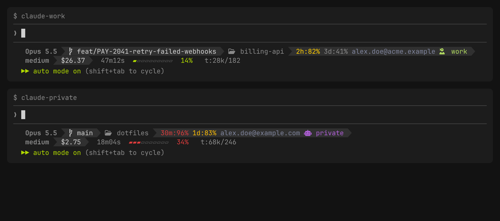

# claude-multiprofile

Several Claude Code accounts (say, work and personal) on one machine, sharing one config: the same `CLAUDE.md`, settings, skills, commands, hooks and plugins. Each account keeps its own login, history, sessions and `.claude.json`. A two-line statusline shows which account a terminal is on.



```
claude            default profile
claude-work       work account
claude-personal   personal account
```

## How it works

Claude Code reads everything from `CLAUDE_CONFIG_DIR`. Each profile is a directory `~/.claude-NAME` whose shared entries are symlinks back into `~/.claude`:

```
~/.claude              shared: CLAUDE.md, settings.json, keybindings.json, skills,
                       commands, agents, plugins, themes, output-styles, hooks, statusline.sh
~/.claude-NAME         one account: credentials, history, sessions, projects, .claude.json
                       plus symlinks to the shared entries above
~/.claude-default      symlink to the default profile
~/bin/claude           dispatcher: sets CLAUDE_CONFIG_DIR from its own name, then runs
                       the real binary at ~/.local/bin/claude
~/bin/claude-NAME      symlink to ~/bin/claude
```

`~/bin` has to come before `~/.local/bin` in `PATH`, so `claude` reaches the dispatcher. A profile can pin a default model in `~/.claude-NAME/model` (one line, e.g. `opus`). That goes through `ANTHROPIC_MODEL` rather than `settings.json`, because the settings file is shared.

On macOS the login lives in the Keychain under a name derived from `CLAUDE_CONFIG_DIR`, so every profile, including the one migrated from `~/.claude`, needs one `/login`. On Linux the credentials file moves with the account, so the migrated profile stays logged in.

Not shared between profiles: history, sessions, projects, `.claude.json` and therefore user-scope MCP servers.

## Setup (for a Claude Code agent)

Do the steps in order. The human decides the profile names, approves each change, and runs the steps marked *human*.

1. **Ask** the human for the profile names, lowercase with dashes (e.g. `work`, `personal`). The first name gets the account currently in `~/.claude`. Also ask for an optional default model per profile.
2. **Check the prerequisites**: macOS or Linux; `jq`, `git` and `shasum` present; Claude Code installed with the native installer at `~/.local/bin/claude`. If it lives elsewhere (`command -v claude`), the human exports `CLAUDE_REAL=/that/path` in their shell rc. The statusline icons need a [Nerd Font](https://www.nerdfonts.com/) in the terminal, which only the human can set.
3. **Clone** this repo anywhere except under `~/.claude*`, e.g. `~/src/claude-multiprofile`.
4. **Install**: run `./claude-profiles.sh install --dry-run`, show the output, and after approval run `./claude-profiles.sh install`. This copies the dispatcher and statusline into place, backs up any differing file as `*.bak-<timestamp>`, and adds the `statusLine` block to `~/.claude/settings.json` unless one is already there.
5. **Fix PATH** if `install` printed `FIX   PATH`. Propose the `export PATH="$HOME/bin:$PATH"` line for the human's shell rc and add it after approval.
6. **Preview the split**: run `./claude-profiles.sh migrate --dry-run NAME1 NAME2`. Show the human the "Moves out of ~/.claude" list. Anything there that should stay shared needs `SHARED_ENTRIES` in the script edited first.
7. *Human*: quit every Claude Code session, including this one, because migrate moves the running session's state. Then, in a plain terminal, run `./claude-profiles.sh migrate NAME1 NAME2` and confirm with `y`.
8. *Human*: optionally pin models with `echo opus > ~/.claude-NAME1/model`. Then open a new shell, run `claude-NAME` for each profile and `/login` with that account.
9. **Verify** with `./claude-profiles.sh check`. Every line should be `ok`.

To add a profile later, run `./claude-profiles.sh add NAME [MODEL]` and then `/login` in `claude-NAME`.

## Undo

`migrate` backs up `~/.claude` and `~/.claude.json` to `~/.claude-migration-backup-<timestamp>/` and writes a `ROLLBACK.sh` there. Rollback restores both, deletes the migrated profile dirs, their `~/bin` links and `~/.claude-default`, and on macOS deletes their Keychain items. Profiles added later with `add` are left in place.

## Update

`git pull`, then `./claude-profiles.sh install` again.

## Statusline

Model, branch, directory, rate limits with time to reset, account email and profile, effort, cost, duration, context bar and token counts. See [statusline.md](statusline.md).

## Development

`make screenshot` regenerates `docs/statusline.png` in Docker from the real `statusline.sh`, using made-up profiles, repos and emails. Run it after changing the statusline; CI doesn't.

`make check` runs shellcheck and the end-to-end test, both in Docker. The test runs against a throwaway `HOME` under bash 3.2 (macOS `/bin/bash`) and bash 5. `make lint` and `make test` run the parts separately.

The test replaces Claude Code and the macOS `security` tool with mocks. A mock login writes the profile's credentials file and a Keychain item named the way Claude Code names it. That covers login isolation between profiles and Keychain cleanup on rollback. A real `/login`, and whether Claude Code still names its Keychain items this way, can only be checked by hand on a Mac.

CI (`.github/workflows/test.yml`) runs lint and both bash versions on every push and PR. The macOS job (real `/bin/bash` 3.2, BSD `cp -c`) only runs when the workflow is started manually with the `macos` input, because in a private repo macOS minutes cost about ten times Linux ones.
