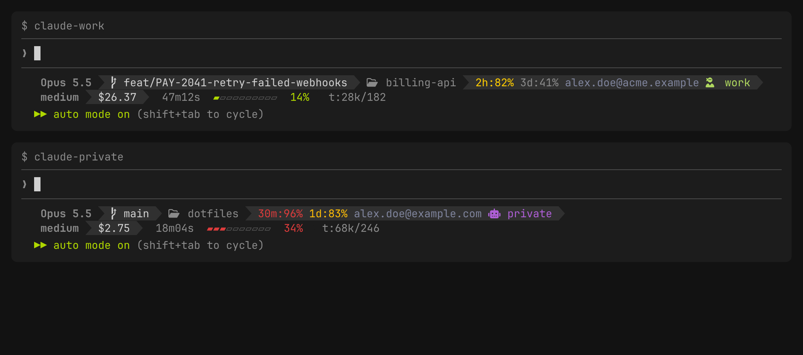

# My statusline for Claude Code

A powerline-style two-line status bar for [Claude Code](https://claude.ai/code) that shows model, git branch, directory, effort level, cost, session duration, context usage, token counts, and rate limits — all at a glance.




## Structure

```
Line 1:  <model> ❯ <branch> ❯ <directory> ❯ <5h-reset>:<5h-%> <7d-reset>:<7d-%> <email> <account>
Line 2:  <effort> ❯ $<cost> ❯ <duration> <context-bar> <context-%>  t:<input>/<output>
```

| Segment | Source field | Example |
|---------|-------------|---------|
| Model | `model.display_name` | `Opus` |
| Branch | `git branch --show-current` | `feat/statusline` |
| Directory | `workspace.current_dir` (basename) | `claude-sandbox` |
| 5h / 7d rate limits | `rate_limits.five_hour`, `.seven_day`: time to reset, then `used_percentage` | `2h:23% 3d:41%` |
| Email | `claude auth status --json`, cached per profile and session | `you@example.com` |
| Account | `CLAUDE_CONFIG_DIR` basename, hashed to a color + icon | ` private` |
| Effort | `effort.level` | `high` |
| Cost | `cost.total_cost_usd` | `$1.42` |
| Duration | `cost.total_duration_ms` | `12m05s` |
| Context bar | `context_window.used_percentage` | `▰▰▰▰▱▱▱▱▱▱ 42%` |
| Tokens | `context_window.total_input_tokens` / `total_output_tokens` | `t:156k/12k` |

## Prerequisites

- [jq](https://jqlang.github.io/jq/) — JSON parser (`brew install jq`)
- A [Nerd Font](https://www.nerdfonts.com/) — the powerline separators (`` ``) and icons (`` branch, `` folder, plus the account icon set) require patched font glyphs

## Installation

See [README.md](README.md): `claude-profiles.sh install` copies the script and adds the `statusLine` block.

## Customization

### Colors

The script uses [256-color ANSI codes](https://en.wikipedia.org/wiki/ANSI_escape_code#8-bit). Key values:

| Variable | Color code | Used for |
|----------|-----------|----------|
| `A_BG` | `234` | Dark background (model, effort segments) |
| `B_BG` | `236` | Mid background (branch, cost segments) |
| `C_BG` | `234` | Dark background (dir, duration segments) |
| `GREEN_FG` | `148` | Filled context bar blocks, percentage |
| `DIM_FG` | `240` | Empty context bar blocks |

Preview 256-color codes:

```bash
for i in {0..255}; do printf "\033[48;5;%sm %3s \033[0m" $i $i; ((i%16==15)) && echo; done
```

### Segments

Each segment follows the pattern:

```bash
printf "$(fg COLOR)$(bg BG) CONTENT ${R}"
printf "$(fg BG)$(bg NEXT_BG)${SEP}${R}"
```

The `SEP` variable (`` ``) creates the powerline arrow. Set its foreground to the *current* segment's background and its background to the *next* segment's background.

### Token formatting

`fmt_tokens` converts raw counts: `500` → `500`, `15600` → `15k`, `1200000` → `1.2M`.

### Account

If you run multiple Claude Code profiles via separate `CLAUDE_CONFIG_DIR` values (e.g. `~/.claude-work`, `~/.claude-private`), the last segment on line 1 shows which one is active — useful when you can't otherwise tell your terminals apart at a glance.

The account name is read straight from the env var:

```bash
ACCOUNT=""
if [[ -n "$CLAUDE_CONFIG_DIR" ]]; then
  ACCOUNT="${CLAUDE_CONFIG_DIR##*.claude-}"
fi
```

Its color and icon are picked deterministically from a char-sum hash of the name, so the same profile always renders the same way, and different profiles get visually distinct combos:

```bash
ACCOUNT_SUM=0
for (( i=0; i<${#ACCOUNT}; i++ )); do
  printf -v CH '%d' "'${ACCOUNT:i:1}"
  ACCOUNT_SUM=$((ACCOUNT_SUM + CH))
done
ACCOUNT_IDX=$((ACCOUNT_SUM % ${#ACCOUNT_PALETTE[@]}))
```

`ACCOUNT_PALETTE` holds 10 muted xterm-256 colors swept across a 0–270° hue range (the 270–360° band is skipped — it lands on magenta/hot-pink, which reads as out of place against the rest of the muted set). `ACCOUNT_ICONS` pairs each color with a distinct Font Awesome "person" glyph (astronaut, ninja, secret agent, robot, graduate, doctor, nurse, injured, digger, ring) at the same index, so a hash bucket always gets a matching color+icon pair. No `CLAUDE_CONFIG_DIR` set → the whole segment (and its separator) is skipped.

## Available data fields

<details>
<summary>Full list of JSON fields Claude Code sends via stdin</summary>

| Field | Description |
|-------|-------------|
| `model.id`, `model.display_name` | Model identifier and name |
| `workspace.current_dir` | Current working directory |
| `workspace.project_dir` | Directory where Claude Code was launched |
| `workspace.added_dirs` | Additional dirs added via `/add-dir` |
| `workspace.git_worktree` | Git worktree name (if in a linked worktree) |
| `workspace.repo.host`, `.owner`, `.name` | Repository identity from `origin` remote |
| `cost.total_cost_usd` | Estimated session cost in USD |
| `cost.total_duration_ms` | Wall-clock time since session start |
| `cost.total_api_duration_ms` | Time spent waiting for API responses |
| `cost.total_lines_added`, `.total_lines_removed` | Lines of code changed |
| `context_window.total_input_tokens` | Input tokens in current context window |
| `context_window.total_output_tokens` | Output tokens from most recent response |
| `context_window.context_window_size` | Max context size (200k or 1M) |
| `context_window.used_percentage` | Pre-calculated context usage % |
| `context_window.current_usage.*` | Per-component breakdown (input, cache write, cache read) |
| `effort.level` | Reasoning effort: `low` / `medium` / `high` / `xhigh` / `max` |
| `thinking.enabled` | Whether extended thinking is on |
| `rate_limits.five_hour.used_percentage` | 5-hour rate limit usage % |
| `rate_limits.seven_day.used_percentage` | 7-day rate limit usage % |
| `exceeds_200k_tokens` | Whether total tokens exceed 200k |
| `session_id`, `session_name` | Session ID and custom name |
| `version` | Claude Code version |
| `vim.mode` | `NORMAL` / `INSERT` / `VISUAL` / `VISUAL LINE` |
| `agent.name` | Agent name (when using `--agent`) |
| `pr.number`, `pr.url`, `pr.review_state` | Open PR info for current branch |
| `worktree.name`, `.path`, `.branch` | Worktree session info |

</details>

## Tips

- The statusline runs locally and **does not consume API tokens**.
- Updates after each assistant message, after `/compact`, and on permission mode changes (debounced at 300ms).
- Add `"refreshInterval": 5` to the settings block to also refresh on a timer (useful while subagents run).
- `COLUMNS` and `LINES` env vars are available inside the script for terminal-width-aware layouts.
- Use `/statusline` command with a natural-language description to generate or regenerate interactively.

## Docs

- [Official statusline documentation](https://code.claude.com/docs/en/statusline)
